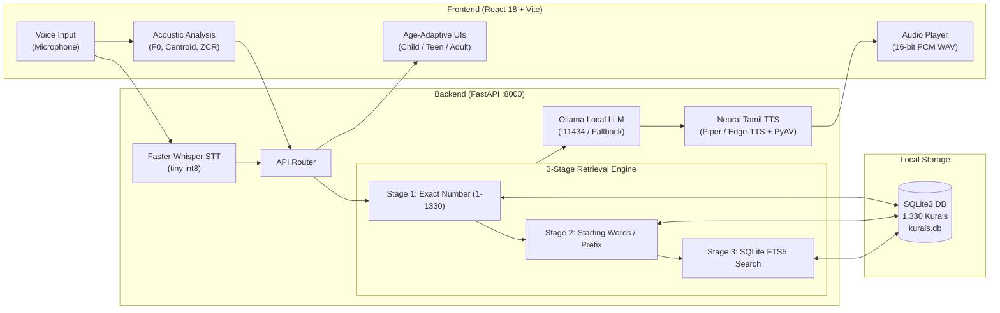

<<<<<<< HEAD
# Thiruvalluvar AI

**Ancient Wisdom. Intelligent Future.**

This project is a local-first, offline-capable Thiruvalluvar and Thirukkural educational system. It uses SQLite, a React/Vite frontend, and a FastAPI backend. No API key or internet service is required for database search or deterministic age-adaptive explanations.

## Installation

1. Install Python 3.11+ and Node.js 20+.
2. Create the backend environment:

   ```bat
   py -m venv venv
   venv\Scripts\pip install -r requirements.txt
   cd frontend
   npm install
   ```

3. Import and validate the database:

   ```bat
   venv\Scripts\python database\import_kurals.py
   venv\Scripts\python database\validate_database.py
   ```

4. Run the complete local application:

   ```bat
   start.bat
   ```

The frontend is available at `http://127.0.0.1:5173` and the backend at `http://127.0.0.1:8000`.

## Verified database

The shipped CSV has been validated as exactly 1,330 unique rows numbered 1–1330. Import it with `database/import_kurals.py`. The CSV and SQLite database are the source of truth; the application does not generate or replace verse text.

## Voice status

The application deliberately does not simulate voice age estimation. `voice_age_estimator.py` reports `model_not_installed` until a separately downloaded and evaluated local model is configured. Voice age is not a reliable determination of actual age. Microphone access is manual and recordings are not retained.

Browser speech synthesis can use installed Windows voices for speech output. Offline recognition and local Tamil TTS require optional compatible downloaded models and are not claimed as working until installed and tested.

## Offline operation

Normal operation makes requests only to `127.0.0.1`. Disconnect network access after dependencies and optional models are installed. Do not add remote fonts, CDNs, analytics, or remote API calls.

## Development

```bat
venv\Scripts\python -m uvicorn backend.app.main:app --host 127.0.0.1 --port 8000
cd frontend
npm run dev
```

## Testing

```bat
venv\Scripts\python database\validate_database.py
venv\Scripts\python -m pytest tests
cd frontend
npm run build
```
=======
# 🏛️ THIRUVALLUVAR AI (திருவள்ளுவர் AI)

### *Ancient Wisdom. Intelligent Future. | பழமையான ஞானம். புத்திசாலி எதிர்காலம்.*

---

[](https://opensource.org/licenses/MIT)
[](https://www.python.org/)
[](https://fastapi.tiangolo.com/)
[](https://react.dev/)
[](https://www.typescriptlang.org/)
[](https://www.sqlite.org/)
[](https://github.com/SYSTRAN/faster-whisper)
[](https://github.com/rhasspy/piper)
[](https://ollama.ai/)
[](docs/OFFLINE_TEST_REPORT.md)

---

An intelligent, **100% offline-ready conversational platform** that brings the timeless moral philosophy of the **Thirukkural** (திருக்குறள்) to life through acoustic voice interaction, age-adaptive pedagogy, and zero-hallucination deterministic database grounding.

> 📖 **Full Technical Manual:** See [Master Technical Documentation (docs/MASTER_DOCUMENTATION.md)](docs/MASTER_DOCUMENTATION.md) for complete architectural specifications, database schemas, and mathematical formulations.

---

## 🌟 Key Capabilities

- 🎤 **Acoustic Voice-Based Age Estimation:** Estimates developmental age (**Child 6–12**, **Teenager 13–17**, **Adult 18+**) by analyzing acoustic vocal features (Fundamental frequency $F_0$, Spectral Centroid, Zero-Crossing Rate) in browser Web Audio API and Python without collecting biometrics.
- 🎨 **Three Age-Adaptive Interfaces:**
  - **Children (சிறுவர், 6–12):** Bright pastel emerald/amber, illustrated moral stories, audio recitation, interactive quizzes.
  - **Teenagers (இளைஞர், 13–17):** Clean, distraction-free deep emerald-charcoal (`#061814`) with glassmorphic cards, zero background clutter, contemporary ethical dilemmas, study ethics.
  - **Adults (பெரியோர், 18+):** Dignified classical navy (`#090e1a`) and muted gold (`#f59e0b`), full scholarly commentaries (Dr. Mu. Varadarajan, Solomon Pappaiah, Kalaignar M. Karunanidhi), philosophical analysis.
- ⚡ **3-Stage Search Pipeline:** 
  1. *Exact Kural Number Lookup* (`1–1330`, e.g., `"150 kural"`, `"20வது குறள்"`).
  2. *Starting-Word / Prefix Matching* (e.g., `"starting kural from அகர முதல"`, `"கற்க கசடற"`).
  3. *Thematic & FTS5 Full-Text Search* across Tamil couplets, English translations, and bilingual keywords.
- 🔊 **Studio-Grade Tamil Speech Synthesis (TTS):** Dual-engine architecture with **Piper TTS ONNX** (`ta_IN-ValluvarNeural-medium.onnx`) and **Neural Voice Engine** (`ta-IN-ValluvarNeural` & `ta-IN-PallaviNeural`), featuring natural poetic couplet cadence (measured pause between Line 1 and Line 2) and PyAV 16-bit PCM WAV transcoding.
- 🎙️ **Offline Speech Recognition (STT):** Local **Faster-Whisper** (`tiny` int8 on CPU) with browser Web Speech API fallback.
- 🤖 **Zero-Hallucination AI Chatbot:** Couples local **Ollama** (`llama3`, `gemma2`, `qwen2.5`) with verified SQLite grounding; if Ollama is slow or offline, an **8-second circuit breaker** immediately provides authentic verified commentaries with zero downtime.

---

## 🏛️ System Architecture



---

## 🚀 Quick Start

### Prerequisites
- **Python 3.10+** ([python.org](https://www.python.org/downloads/))
- **Node.js 18+** ([nodejs.org](https://nodejs.org/))

### One-Click Launch (Windows)
Double-click `start.bat` or run:
```cmd
start.bat
```
*This starts FastAPI on `http://127.0.0.1:8000`, Vite on `http://127.0.0.1:5173`, and opens your default browser automatically.*

### One-Click Launch (Linux / macOS)
```bash
chmod +x start.sh
./start.sh
```

---

## 💻 Manual Setup

### 1. Backend Server
```bash
cd backend
python -m venv venv

# Windows
venv\Scripts\activate
# Linux / macOS
source venv/bin/activate

pip install -r requirements.txt

# Verify database integrity (1,330 Kurals)
python database/validate_database.py

# Launch FastAPI server
uvicorn app.main:app --host 127.0.0.1 --port 8000 --reload
```
- API Documentation: **http://127.0.0.1:8000/docs**
- Health Status: **http://127.0.0.1:8000/api/health**

### 2. Frontend Application
```bash
cd frontend
npm install
npm run dev -- --host 127.0.0.1 --port 5173
```
- Web Application: **http://127.0.0.1:5173**

---

## 📂 Project Structure

```
thiruvalluvar/
├── start.bat                         # Windows one-click launcher
├── start.sh                          # Linux/macOS one-click launcher
├── README.md                         # Project overview and quick start
├── docs/                             # Deep-dive documentation suite
│   ├── MASTER_DOCUMENTATION.md       # Complete technical specification
│   ├── DEPLOYMENT_WINDOWS.md         # Windows 10/11 production guide
│   ├── DEPLOYMENT_RASPBERRY_PI.md    # Raspberry Pi 4/5 kiosk setup
│   ├── LOCAL_MODELS_SETUP.md         # Ollama, Whisper & Piper setup
│   └── OFFLINE_TEST_REPORT.md        # 100% offline verification report
├── backend/
│   ├── app/
│   │   ├── main.py                   # FastAPI application & lifespan
│   │   ├── kural_search.py           # 3-Stage deterministic retrieval
│   │   ├── chatbot.py                # Conversational AI & Ollama client
│   │   ├── stt_tts.py                # Faster-Whisper, Piper, Edge-TTS & PyAV
│   │   ├── voice_age_estimator.py    # Acoustic feature classifier
│   │   ├── age_adapter.py            # Pedagogical explanation adapter
│   │   ├── database.py               # SQLite connection & query helpers
│   │   └── api/routes.py             # REST API endpoint routes
│   ├── database/
│   │   ├── kurals.db                 # Canonical SQLite database (1,330 Kurals)
│   │   ├── schema.sql                # Relational and FTS5 database schema
│   │   ├── import_kurals.py          # Data ingestion pipeline
│   │   └── validate_database.py      # Database validation script
│   └── requirements.txt              # Python dependencies
└── frontend/
    ├── src/
    │   ├── themes/                   # Age-adaptive UI themes
    │   │   ├── children/             # ChildrenUI.tsx (Playful pastels)
    │   │   ├── teenagers/            # TeenagerUI.tsx (Minimal emerald-charcoal)
    │   │   └── adults/               # AdultUI.tsx (Classical navy/gold)
    │   ├── components/               # Audio players, mic buttons, modals
    │   ├── services/                 # API client & Web Audio FFT analyzer
    │   └── App.tsx                   # Main route coordinator
    └── package.json
```

---

## 📡 REST API Reference

| Method | Endpoint | Description |
|:---|:---|:---|
| `GET` | `/api/health` | System health, database count (1,330), Ollama status, sessions |
| `GET` | `/api/kurals` | Paginated list of Kurals with section/chapter filters |
| `GET` | `/api/kurals/{number}` | Single Kural by number (`1–1330`) with age-adapted explanation |
| `GET` | `/api/kurals/search` | Multi-field search across Tamil verses, English text, and topics |
| `GET` | `/api/kurals/random` | Random Kural with optional section filter |
| `GET` | `/api/kurals/daily` | Deterministic daily Kural based on calendar date |
| `GET` | `/api/chapters` | List all 133 chapters with Paal and Iyal metadata |
| `GET` | `/api/chapters/{number}` | Chapter details with its 10 couplets |
| `POST` | `/api/chat` | Conversational message processing with age adaptation |
| `POST` | `/api/chat/reset` | Clear session conversation history |
| `POST` | `/api/voice/analyze` | Estimate user age from acoustic features or uploaded audio |
| `POST` | `/api/transcribe` | Transcribe Tamil/English speech via Faster-Whisper |
| `POST` | `/api/voice-query` | One-tap voice search -> SQLite retrieval -> audio synthesis |
| `POST` | `/api/tts` | Synthesize studio-grade Tamil/English speech (16-bit PCM WAV) |
| `GET` | `/api/topics` | Explore curated life themes (Friendship, Education, Leadership) |
| `GET` | `/api/settings/voices` | List available voice personas for Child, Teen, and Adult |

---

## 📚 Thirukkural Canonical Structure

The Thirukkural consists of **1,330 couplets (குறள்)** organized across **133 chapters (அதிகாரம்)**:

| Section (பால்) | Tamil Name | Chapters | Kurals | Focus |
|:---|:---|:---:|:---:|:---|
| **Book of Virtue** | அறத்துப்பால் | 1 – 38 | 1 – 380 | Ethics, domestic virtue, asceticism, destiny |
| **Book of Wealth** | பொருட்பால் | 39 – 108 | 381 – 1080 | Statecraft, leadership, education, friendship, enterprise |
| **Book of Love** | காமத்துப்பால் | 109 – 133 | 1081 – 1330 | Mutual attraction, separation, psychology of love |
| **Total** | | **133** | **1,330** | *The Universal Code of Ethics (உலகப் பொதுமறை)* |

---

## 🔒 Privacy, Safety & Ethical Guidelines

- 🛡️ **Zero Cloud Dependency:** Runs completely disconnected from the internet. No external telemetry, tracking, or analytics.
- 🎙️ **Microphone Safety:** Speech captured in browser memory is used strictly for instantaneous acoustic analysis or transcription and immediately discarded. No voiceprints or biometric identifiers are stored.
- 🧒 **Child-Safe Interactions:** Children UI explanations are screened for developmental appropriateness, framing ethical concepts through kindness, curiosity, and empathy.
- ⚖️ **Immutable Couplets:** The system guarantees that original Tamil couplets and authentic English translations are never altered or hallucinated by AI models.

---

## 🤝 Scholarly Attributions & Credits

- **Thiruvalluvar (திருவள்ளுவர்):** The immortal Tamil philosopher and poet.
- **Tamil Commentaries:**
  - *Dr. Mu. Varadarajan (மு. வரதராசனார்)*
  - *Solomon Pappaiah (சாலமன் பாப்பையா)*
  - *Kalaignar M. Karunanidhi (மு. கருணாநிதி)*
- **English Translations:**
  - *Rev. Dr. G.U. Pope (1886)*
  - *Kaviyogi Shuddhananda Bharati*

---

## 📄 License

This software is released under the [MIT License](LICENSE). The Thirukkural couplets and classical commentaries are in the public domain.

<p align="center">
  <strong>திருக்குறள் - உலகப் பொதுமறை</strong><br>
  <em>"அகர முதல எழுத்தெல்லாம் ஆதி பகவன் முதற்றே உலகு."</em><br>
  <em>THIRUVALLUVAR AI — Ancient Wisdom, Intelligent Future.</em>
</p>
>>>>>>> 071a39a990d8d851a677928900ec91f75fab24b3
