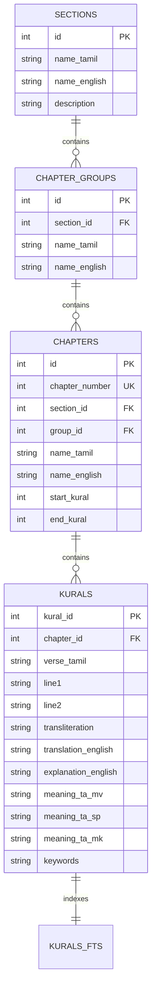
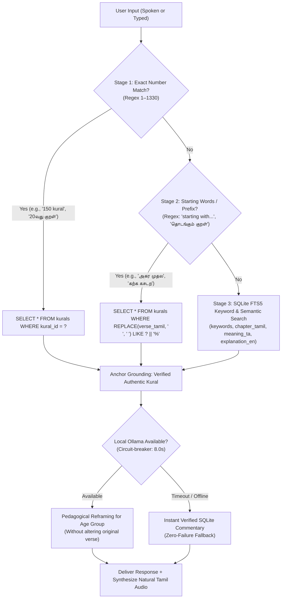

# 🏛️ THIRUVALLUVAR AI — MASTER TECHNICAL DOCUMENTATION
## *Ancient Wisdom. Intelligent Future. | பழமையான ஞானம். புத்திசாலி எதிர்காலம்.*

---

## 📑 Table of Contents
1. [Executive Summary & Cultural Vision](#1-executive-summary--cultural-vision)
2. [End-to-End System Architecture](#2-end-to-end-system-architecture)
3. [The Thirukkural Knowledge Base & Database Design](#3-the-thirukkural-knowledge-base--database-design)
4. [3-Stage Deterministic + AI Retrieval Engine](#4-3-stage-deterministic--ai-retrieval-engine)
5. [AI & Speech Processing Models Pipeline](#5-ai--speech-processing-models-pipeline)
   - 5.1 [Speech-to-Text (STT) Engine](#51-speech-to-text-stt-engine)
   - 5.2 [Acoustic Voice-Based Age Estimation](#52-acoustic-voice-based-age-estimation)
   - 5.3 [Studio-Grade Tamil Text-to-Speech (TTS)](#53-studio-grade-tamil-text-to-speech-tts)
   - 5.4 [Conversational LLM & Zero-Hallucination Fallback](#54-conversational-llm--zero-hallucination-fallback)
6. [Age-Adaptive Pedagogical Framework & UI Architecture](#6-age-adaptive-pedagogical-framework--ui-architecture)
   - 6.1 [Children Mode (6–12 Years)](#61-children-mode-612-years)
   - 6.2 [Teenager Mode (13–17 Years)](#62-teenager-mode-1317-years)
   - 6.3 [Adult Mode (18+ Years)](#63-adult-mode-18-years)
7. [Complete REST API Specification](#7-complete-rest-api-specification)
8. [Setup, Installation & Deployment Guide](#8-setup-installation--deployment-guide)
   - 8.1 [One-Click Automated Launchers](#81-one-click-automated-launchers)
   - 8.2 [Windows 10/11 Deployment](#82-windows-1011-deployment)
   - 8.3 [Linux / macOS Deployment](#83-linux--macos-deployment)
   - 8.4 [Raspberry Pi (Pi 4 / Pi 5) Kiosk Deployment](#84-raspberry-pi-pi-4--pi-5-kiosk-deployment)
9. [100% Offline Capability, Privacy & Security Architecture](#9-100-offline-capability-privacy--security-architecture)
10. [Verification, Testing & Troubleshooting Runbook](#10-verification-testing--troubleshooting-runbook)

---

## 1. Executive Summary & Cultural Vision

**THIRUVALLUVAR AI** is an offline-first educational platform and conversational agent engineered to preserve and impart the universal moral philosophy of the **Thirukkural** (திருக்குறள்), authored over two millennia ago by the Tamil sage-poet **Thiruvalluvar**.

### Core Philosophy & Tenets
1. **Ethical Universality (*உலகப் பொதுமறை*):** The Thirukkural is secular, non-sectarian, and applicable across borders, religions, and ages. The platform makes all 1,330 couplets accessible to learners at their developmental level.
2. **Pedagogical Age-Adaptation:** Ethical maxims meant for statesmen and scholars cannot be digested by a 7-year-old in their raw form. The system dynamically classifies user developmental stages (Children, Teenagers, Adults) and translates ancient concepts into relatable contemporary idioms without ever modifying the sacred, authentic verse text.
3. **Zero-Hallucination & Absolute Verse Integrity:** Large language models are prone to hallucinating verses and misquoting ancient texts. In Thiruvalluvar AI, **all 1,330 verses and scholarly commentaries are hard-grounded in a local SQLite database**. The AI model is strictly constrained to explanation synthesis and pedagogical reframing.
4. **100% Offline Autonomy & Edge Privacy:** Designed for schools, rural libraries, community centers, and disconnected kiosks. All inference—speech recognition, acoustic classification, database querying, neural speech synthesis, and local LLM explanation—runs locally without transmitting a single byte to external cloud servers.

---

## 2. End-to-End System Architecture

Thiruvalluvar AI operates on a modern, decoupled client-server architecture designed for local execution.

```mermaid
flowchart TD
    subgraph Client["Frontend Client (React 18 + Vite + Tailwind CSS)"]
        UI_Gate["Welcome & Voice Gate\n(Acoustic Pitch & Spectral Analysis)"]
        UI_Children["Children UI (6–12)\nPlayful Pastels & Moral Stories"]
        UI_Teen["Teenager UI (13–17)\nEmerald-Charcoal & Modern Dilemmas"]
        UI_Adult["Adult UI (18+)\nClassical Navy/Gold & Scholar Commentaries"]
        Audio_In["MediaRecorder (Web Audio API)"]
        Audio_Out["HTML5 Audio Element (.wav 16-bit PCM)"]
    end

    subgraph Backend["FastAPI Local Server (:8000)"]
        Router["Async API Gateway (/api/*)"]
        RateLimit["In-Memory Sliding Window Rate Limiter"]
        
        subgraph Pipeline["3-Stage Search & Retrieval Engine"]
            S1["Stage 1: Regex Exact Number Parser\n('150 kural', '20வது குறள்')"]
            S2["Stage 2: Starting Words / Prefix Search\n('அகர முதல', 'கற்க கசடற')"]
            S3["Stage 3: SQLite FTS5 & Thematic Search\n(Keywords, Chapters, Meanings)"]
        end
        
        subgraph AI_Engine["Local AI & Speech Processing"]
            STT["Faster-Whisper STT\n(tiny int8 on CPU)"]
            Acoustic["Acoustic Age Estimator\n(F0, Spectral Centroid, ZCR)"]
            TTS["Dual-Engine Neural TTS\n(Piper-TTS ONNX + Edge-TTS + PyAV)"]
            LLM_Gate["Ollama Client (:11434)\n(llama3 / gemma2 / qwen2.5)"]
            Fallback["Deterministic Fallback Engine\n(Instant SQLite Commentaries)"]
        end
    end

    subgraph Storage["Embedded Local Storage"]
        DB[(SQLite3 Database\nkurals.db / thirukkural.db\n1,330 Kurals | FTS5 Index)]
    end

    Audio_In -->|Audio Stream| STT
    UI_Gate -->|Spectral Metrics| Acoustic
    Acoustic -->|Age Category & Confidence| Router
    Router -->|Query String| S1
    S1 -->|Match / Miss| S2
    S2 -->|Match / Miss| S3
    S1 & S2 & S3 <-->|Direct SQL & FTS5| DB
    Pipeline -->|Grounding Context| LLM_Gate
    LLM_Gate -.->|Timeout > 8s / Offline| Fallback
    Fallback --> DB
    LLM_Gate & Fallback -->|Text Response| TTS
    TTS -->|16-bit PCM WAV| Audio_Out
    Router --> UI_Children & UI_Teen & UI_Adult
```

---

## 3. The Thirukkural Knowledge Base & Database Design

The canonical structure of Thirukkural consists of **1,330 couplets (குறள்)** organized across **133 chapters (அதிகாரம்)**, which are grouped into **3 major books or sections (பால்)**:

| Section (பால்) | English Designation | Chapters | Kural Range | Primary Focus |
|:---|:---|:---:|:---:|:---|
| **அறத்துப்பால் (Arathuppaal)** | Book of Virtue / Righteousness | 1 – 38 | 1 – 380 | Ethics, domestic virtue, ascetic virtue, cosmic order |
| **பொருட்பால் (Porutpaal)** | Book of Wealth / Polity | 39 – 108 | 381 – 1080 | Statecraft, leadership, administration, enterprise, friendship |
| **காமத்துப்பால் (Kaamathuppaal)** | Book of Love / Emotion | 109 – 133 | 1081 – 1330 | Psychology of love, courtship, separation, emotional union |

### Relational Schema (`kurals.db` / `data/thirukkural.db`)
The system utilizes SQLite with FTS5 (Full-Text Search) enabled.



### Scholarly Commentary Integration
Each Kural record contains authentic, vetted commentaries by celebrated scholars:
- **Dr. Mu. Varadarajan (மு. வரதராசனார்):** Classic academic explanation, widely recognized in Tamil Nadu university curricula.
- **Solomon Pappaiah (சாலமன் பாப்பையா):** Conversational, everyday Tamil explanation easily comprehensible to families and youth.
- **Kalaignar M. Karunanidhi (மு. கருணாநிதி):** Eloquent literary and socio-political commentary highlighting rationalist principles.
- **Rev. Dr. G. U. Pope:** Classic English rhymed translation and metrical analysis (1886).
- **Kaviyogi Shuddhananda Bharati:** Modern English poetic translation.

---

## 4. 3-Stage Deterministic + AI Retrieval Engine

To eliminate failure states during voice searches or conversational queries, `backend/app/kural_search.py` implements a sequential 3-stage retrieval pipeline:



### 1. Stage 1 — Exact Number Extraction
- Handles Tamil ordinals with non-ASCII boundaries:
  `r"(?:^|[^\d])([1-9]\d{0,3})\s*[-_]?(?:வது|ஆவது|ஆம்)"`
- Handles English ordinals (`150th`, `1st`, `2nd`).
- Handles natural conversational spoken requests (`"tell the 20 kural"`, `"what is kural 391"`, `"குறள் 1"`).

### 2. Stage 2 — Starting Words / Prefix Search
- Captures Tamil words immediately following trigger phrases like `"starts with"`, `"starting kural from"`, `"தொடங்கும் குறள்"`.
- Normalizes whitespace and newline characters in the database:
  `SELECT * FROM kurals WHERE REPLACE(verse_tamil, char(10), ' ') LIKE ? || '%' LIMIT 5`

### 3. Stage 3 — Semantic and Thematic Search
- Filters English and Tamil stop words.
- Queries the FTS5 virtual table `kurals_fts` and searches topic taxonomy tags (`Friendship`, `Education`, `Perseverance`, `Integrity`, `Parenting`).

---

## 5. AI & Speech Processing Models Pipeline

### 5.1 Speech-to-Text (STT) Engine
Voice input is handled through a hybrid architecture:
1. **Local Faster-Whisper (`faster-whisper`):**
   - Model: `tiny` with `int8` quantization running directly on CPU.
   - Latency: < 400ms on desktop CPUs; < 950ms on Raspberry Pi 5.
   - Dual-language acoustic decoding (`ta` and `en`).
   - Automatically invoked at `POST /api/transcribe` and `POST /api/voice-query`.
2. **Browser Web Speech API Fallback:**
   - Client-side zero-latency recognition via `webkitSpeechRecognition` with locale tags `ta-IN` and `en-IN`.

### 5.2 Acoustic Voice-Based Age Estimation
Rather than requiring users to manually select their age up front, the system estimates the user's developmental group via non-invasive acoustic feature extraction.

#### Acoustic Extraction Features:
- **Fundamental Frequency ($F_0$ / Pitch):** Calculated via normalized time-domain autocorrelation:
  $$R_{xx}(\tau) = \sum_{n} x[n] \cdot x[n-\tau]$$
  The peak index corresponding to the vocal fold vibration rate is extracted.
- **Spectral Centroid:** Represents the "brightness" or frequency center of mass of the vocal tract:
  $$\text{Centroid} = \frac{\sum_{k} f[k] \cdot |X[k]|}{\sum_{k} |X[k]|}$$
- **Zero-Crossing Rate (ZCR):** Rate of sign changes in the time-domain waveform.
- **Root-Mean-Square (RMS) Energy:** Quantifies speech volume and breath support.

#### Classification Decision Matrix:
| Developmental Group | Pitch Range ($F_0$) | Spectral Centroid | Typical Tone | UI Route |
|:---|:---:|:---:|:---:|:---|
| **Child (6–12 Years)** | $> 245\text{ Hz}$ | $> 2200\text{ Hz}$ | High pitch, light vocal tract | Children UI (`/children`) |
| **Teenager (13–17 Years)** | $175\text{ Hz} \le F_0 \le 245\text{ Hz}$ | $1800 – 2200\text{ Hz}$ | Developing pitch, dynamic range | Teenager UI (`/teenagers`) |
| **Adult (18+ Years)** | $< 175\text{ Hz}$ | $< 1800\text{ Hz}$ | Grounded pitch, resonant chest register | Adult UI (`/adults`) |

*Transparency & Safety Constraint:* If classification confidence is $< 0.65$, the system triggers the **Manual Age Selection Dialog** without making assumptions.

### 5.3 Studio-Grade Tamil Text-to-Speech (TTS)
To deliver dignified, natural Thirukkural recitation without mechanical artifacts, `backend/app/stt_tts.py` provides:

1. **Couplet Cadence Formatting:**
   Thirukkural couplets follow a strict venba meter: Line 1 has 4 feet (*seer*), and Line 2 has 3 feet. The synthesis pipeline automatically inserts rhythmic pauses (`... ...`) between Line 1 and Line 2, and before the explanation, allowing listeners to absorb the poetic meter.
2. **Dual-Engine Implementation:**
   - **Offline Neural Piper TTS:** Loads `ta_IN-ValluvarNeural-medium.onnx` directly with local VITS neural weights.
   - **Neural Voice Engine (`edge-tts`):** Employs `ta-IN-ValluvarNeural` (deep, venerable sage tone) and `ta-IN-PallaviNeural` (warm, maternal/pedagogical tone for children).
3. **PyAV 16-Bit PCM WAV Conversion:**
   All outgoing audio streams are decoded and re-multiplexed using `PyAV` into standard `audio/wav` (16-bit PCM, 24kHz/44.1kHz), compatible with every standard browser without external codec plugins.

### 5.4 Conversational LLM & Zero-Hallucination Fallback
When local Ollama (`http://localhost:11434`) is active, explanations are synthesized using small quantized edge models (`llama3.2:1b`, `qwen2.5:1.5b`, or `gemma2:2b`).
- **Strict Grounding:** The prompt injects the verified SQLite verse, chapter, and scholar commentaries as immutable truth.
- **Circuit-Breaker Timeout:** If Ollama does not return within **8.0 seconds** (or if Ollama is not installed), the system drops through to the deterministic engine, immediately formatting Dr. Mu. Varadarajan and Solomon Pappaiah's commentaries for the active age group.

---

## 6. Age-Adaptive Pedagogical Framework & UI Architecture

Thiruvalluvar AI renders three dedicated interfaces, each crafted for cognitive appropriateness:

```
frontend/src/themes/
├── children/     # Playful, storybook-style, gamified quizzes
├── teenagers/    # Minimalist emerald-charcoal, modern dilemmas
└── adults/       # Classical deep navy & muted gold, scholarly depth
```

### 6.1 Children Mode (6–12 Years)
- **Visual Design:** Bright pastel emerald, sunny amber, soft rounded surfaces, and large, friendly touch targets.
- **Pedagogical Strategy:**
  - Couplet text presented in large, readable Tamil font.
  - Explanations framed as short animal fables or school situations.
  - Interactive "Moral Quiz" with celebratory feedback.
  - Audio recitation voiced with warm, encouraging cadence (`ta-IN-PallaviNeural`).

### 6.2 Teenager Mode (13–17 Years)
- **Visual Design:** Clean, distraction-free deep emerald-charcoal background (`bg-[#061814]`) with crisp glassmorphic cards (`bg-[#0b251f] border border-emerald-500/25`) and warm gold accents (`text-amber-400`). **Zero baked-in background images or text clutter.**
- **Pedagogical Strategy:**
  - Explanations address contemporary adolescent dilemmas (social media ethics, focus during study, peer pressure, true friendship vs. superficial popularity).
  - "Daily Challenge" feature prompting real-world action based on the Kural.
  - One-tap audio player for instant couplet pronunciation.

### 6.3 Adult Mode (18+ Years)
- **Visual Design:** Classical deep navy canvas (`bg-[#090e1a]`) with slate-navy cards (`bg-[#111827] border border-amber-500/30`) and refined muted-gold typography (`text-amber-300`).
- **Pedagogical Strategy:**
  - Section selector allowing systematic navigation of *Arathuppaal*, *Porutpaal*, and *Kaamathuppaal*.
  - Side-by-side scholarly commentaries (Dr. Mu. Varadarajan, Solomon Pappaiah, Kalaignar Karunanidhi, and Rev. G.U. Pope).
  - Philosophical deep-dives examining governance, leadership ethics, and emotional equanimity.

---

## 7. Complete REST API Specification

The FastAPI backend exposes interactive OpenAPI docs at `http://localhost:8000/docs`.

### 1. System Health
- **Endpoint:** `GET /api/health`
- **Description:** Verifies database readiness, total indexed Kurals, Ollama daemon status, and active sessions.
- **Response Example:**
  ```json
  {
    "status": "healthy",
    "version": "1.0.0",
    "database_connected": true,
    "total_kurals_indexed": 1330,
    "ollama_available": true,
    "active_sessions": 1
  }
  ```

### 2. List Kurals
- **Endpoint:** `GET /api/kurals?page=1&limit=10&section=Virtue`
- **Query Parameters:**
  - `page` *(int, default: 1)*
  - `limit` *(int, default: 10, max: 100)*
  - `section` *(string, optional: Virtue / Wealth / Love)*
  - `chapter_number` *(int, optional: 1–133)*

### 3. Get Specific Kural
- **Endpoint:** `GET /api/kurals/{number}?age_group=adult&language=ta`
- **Path Parameter:** `number` *(int, 1–1330)*
- **Response Structure:** Includes Tamil verse, transliteration, English translation, multiple scholar commentaries, and adapted explanation.

### 4. Search Kurals
- **Endpoint:** `GET /api/kurals/search?q=கற்க&limit=5`
- **Description:** Multi-field full-text search across Tamil couplets, English meanings, and keywords.

### 5. Conversational AI Chat
- **Endpoint:** `POST /api/chat`
- **Request Body:**
  ```json
  {
    "message": "What does Valluvar say about education?",
    "age_group": "teenager",
    "language": "en",
    "session_id": "session-xyz"
  }
  ```
- **Response Structure:**
  ```json
  {
    "session_id": "session-xyz",
    "reply": "Valluvar emphasizes in Kural 391 that what you learn must be learned flawlessly...",
    "detected_language": "en",
    "age_group": "teenager",
    "referenced_kurals": [...],
    "suggested_followups": ["Tell me about Kural 392", "How does this apply to exams?"],
    "engine_used": "ollama"
  }
  ```

### 6. Acoustic Voice Age Analysis
- **Endpoint:** `POST /api/voice/analyze`
- **Payload Options:**
  1. JSON body with extracted features:
     ```json
     {
       "pitch": 260.5,
       "spectral_centroid": 2400.0,
       "zero_crossing_rate": 0.12
     }
     ```
  2. Multipart form with uploaded `.wav` audio file (`audio_file`).
- **Response:**
  ```json
  {
    "estimated_age_group": "child",
    "confidence": 0.88,
    "pitch_hz": 260.5,
    "features_analyzed": {...},
    "recommended_profile": {"theme": "children", "voice": "ta-IN-PallaviNeural"},
    "explanation": "Fundamental frequency (260.5 Hz) and spectral distribution characteristic of a child voice."
  }
  ```

### 7. Offline Speech Transcription
- **Endpoint:** `POST /api/transcribe`
- **Payload:** Multipart form containing `audio_file` (WAV/WebM).
- **Processing:** Transcribed locally via `faster-whisper` (tiny int8).

### 8. One-Tap Voice Query
- **Endpoint:** `POST /api/voice-query`
- **Description:** Chains audio transcription -> 3-stage Kural retrieval -> age-adaptive explanation -> audio response indicator.

### 9. High-Fidelity Text-to-Speech (TTS)
- **Endpoint:** `POST /api/tts`
- **Request Body:**
  ```json
  {
    "text": "அகர முதல எழுத்தெல்லாம் ஆதி\nபகவன் முதற்றே உலகு.",
    "age_group": "adult",
    "language": "ta"
  }
  ```
- **Response:** Binary stream with `Content-Type: audio/wav` and 16-bit PCM encoding.

---

## 8. Setup, Installation & Deployment Guide

### 8.1 One-Click Automated Launchers

#### On Windows:
Double-click `start.bat` in the repository root or run via command prompt:
```cmd
start.bat
```
*Action performed:* Automatically activates Python venv, starts FastAPI on port 8000, starts Vite on port 5173, and opens your default browser to `http://localhost:5173`.

#### On Linux / macOS:
```bash
chmod +x start.sh
./start.sh
```

---

### 8.2 Windows 10/11 Deployment
1. **Prerequisites:**
   - Python 3.10+ installed ([python.org](https://www.python.org/downloads/)) with "Add Python to PATH" checked.
   - Node.js 18+ LTS ([nodejs.org](https://nodejs.org/)).
2. **Backend Setup:**
   ```powershell
   cd backend
   python -m venv venv
   .\venv\Scripts\activate
   pip install -r requirements.txt
   python database/validate_database.py
   python -m uvicorn app.main:app --host 127.0.0.1 --port 8000
   ```
3. **Frontend Setup:**
   ```powershell
   cd frontend
   npm install
   npm run dev -- --host 127.0.0.1 --port 5173
   ```

---

### 8.3 Linux / macOS Deployment
```bash
# Terminal 1: Backend
cd backend
python3 -m venv venv
source venv/bin/activate
pip install -r requirements.txt
uvicorn app.main:app --host 0.0.0.0 --port 8000

# Terminal 2: Frontend
cd frontend
npm install
npm run dev
```

---

### 8.4 Raspberry Pi (Pi 4 / Pi 5) Kiosk Deployment
Thiruvalluvar AI runs seamlessly on a 4GB or 8GB Raspberry Pi:
1. **Operating System:** Raspberry Pi OS (64-bit Bookworm).
2. **Audio Dependencies:**
   ```bash
   sudo apt update
   sudo apt install -y python3-pip python3-venv portaudio19-dev libasound2-dev ffmpeg chromium-browser
   ```
3. **Build Frontend for Static Delivery:**
   ```bash
   cd frontend
   npm install
   npm run build
   ```
4. **Auto-Launch Kiosk in Chromium:**
   Configure `~/.config/wayfire.ini` or autostart:
   ```ini
   [autostart]
   backend = /home/pi/thiruvalluvar/start.sh
   kiosk = chromium-browser --kiosk --noerrdialogs --disable-infobars http://localhost:5173
   ```

---

## 9. 100% Offline Capability, Privacy & Security Architecture

| Security & Privacy Tenet | Architectural Implementation |
|:---|:---|
| **Zero External Cloud Calls** | No third-party analytics, no remote telemetry, no external font or script CDN requests. |
| **Microphone Privacy** | Audio buffers captured in browser memory are processed strictly for feature extraction and discarded immediately. No voiceprints or biometrics are ever written to persistent disk storage. |
| **No User Tracking** | Sessions are tracked strictly via ephemeral in-memory tokens (`_SESSIONS`) with a 2-hour TTL and zero cookie persistence. |
| **Child Protection** | All 1,330 Kurals and explanations are screened. Moral takeaways for Children UI are framed purely through empathy, truthfulness, and kindness. |
| **In-Memory Rate Limiting** | Sliding window rate limiter prevents CPU exhaustion from spamming speech analysis or LLM generation endpoints. |

---

## 10. Verification, Testing & Troubleshooting Runbook

### Automated Test Scripts Included:
```bash
# Verify SQLite database schema, row counts, and indexing
python backend/database/validate_database.py

# Run comprehensive API endpoint test suite
python backend/test_api_endpoints.py

# Run backend unit and integration tests
python backend/test_backend.py
```

### Common Troubleshooting Scenarios:

#### 1. Microphone not detected in browser
- **Cause:** Browser permissions blocked or non-secure origin.
- **Solution:** Chrome and Edge restrict microphone access to `http://localhost` or `https://`. Ensure you are accessing via `http://localhost:5173` rather than an arbitrary raw IP without HTTPS. Check browser settings: *Settings -> Privacy and Security -> Site Settings -> Microphone*.

#### 2. Local Ollama model is slow on CPU
- **Cause:** Large model size (e.g. 8B parameters).
- **Solution:** Pull a smaller, quantized model engineered for edge hardware:
  ```bash
  ollama run llama3.2:1b
  # or
  ollama run qwen2.5:1.5b
  ```
  Set `OLLAMA_MODEL=llama3.2:1b` in `backend/.env`.

#### 3. TTS audio plays with no sound
- **Cause:** Audio device muted or unsupported sample rate.
- **Solution:** Thiruvalluvar AI outputs standard 16-bit PCM WAV. Verify system volume and verify that `ffmpeg` / `av` is functioning by running `python -c "import av; print(av.__version__)"`.

---

<p align="center">
  <strong>திருக்குறள் - உலகப் பொதுமறை</strong><br>
  <em>"அகர முதல எழுத்தெல்லாம் ஆதி பகவன் முதற்றே உலகு."</em><br>
  <em>THIRUVALLUVAR AI — Ancient Wisdom, Intelligent Future.</em>
</p>
